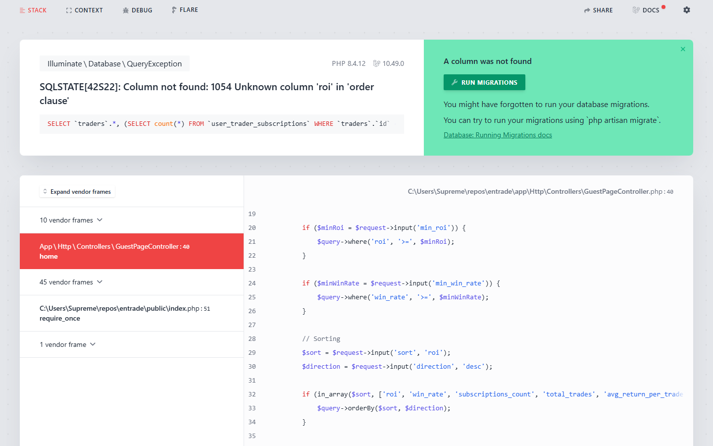
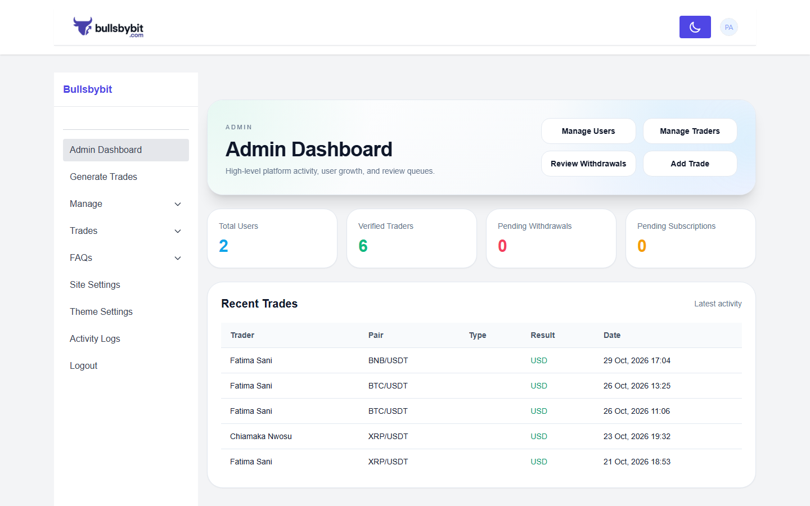
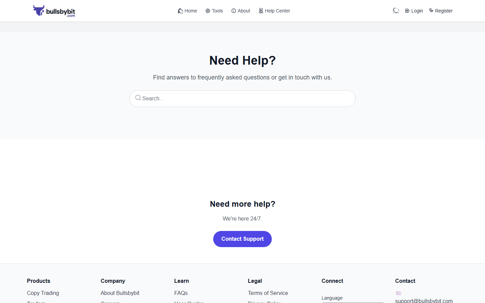
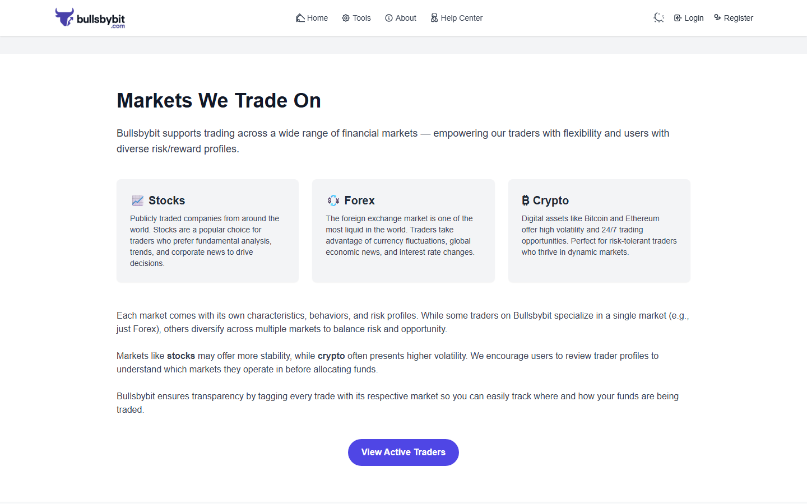

# Entrade / Bullsbybit — Crypto Copy-Trading Platform

> A social copy-trading platform where retail investors evaluate professional traders by verified performance, subscribe, and have trades replicated automatically — with KYC, crypto deposits, referrals and an admin back office.

| | |
|---|---|
| **Role** | Solo — product design, backend, Livewire frontend, payments, admin |
| **Timeline** | 2026 · 211 commits |
| **Stack** | Laravel 10 · PHP 8.1+ · Livewire 3 · Jetstream · Sanctum · Spatie Permissions · MySQL · Tailwind + Bootstrap · Alpine.js · Chart.js · Pusher/Echo · Plisio |
| **Domain** | Copy trading, portfolio analytics, KYC, crypto payments |

> **The source code for this project is private.** This repository is a technical case study with real screenshots from the running application. Code walkthroughs available on request.

---

## The problem

Copy trading products live or die on trust. If the leaderboard numbers are not derived from real closed trades, the whole product is a marketing page. If deposits and withdrawals are not auditable, it is a liability. If KYC is a PDF attached to an email, it is a compliance problem.

This platform was built around three commitments:

1. **Performance is computed, not typed in.** ROI, win rate and per-timeframe series are derived from trade records.
2. **Money moves through explicit states** — deposit → wallet → subscription allocation → trade outcome → balance.
3. **Every action leaves a trail.** Activity logs, admin impersonation tracking and role boundaries.

---

## Product tour

### Marketing surface



Positioning, trust signals and the two paths that matter: browse verified traders, or register.

### Admin dashboard



Platform activity at a glance: total users, verified traders, pending withdrawals, pending subscriptions, and the most recent trades across all traders. Every panel links to the queue that resolves it.

### Help centre



A managed FAQ system (categories, articles, slugs, search) so support content is data, not hardcoded pages.

### Markets



Market coverage explained per asset class — stocks, forex, crypto — with trades tagged by market so an investor can see what a trader actually operates in.

---

## What is in the system

### Trading
- Trader leaderboard with multi-timeframe analytics (1W, 1M, 12M) computed from trade history
- Trader profiles and side-by-side comparison
- Subscriptions with allocated capital and subscription states
- Automated trade replication through queued jobs
- Trade history with entry/exit, ROI and duration
- Market data ingestion (OHLCV) and a **backtesting simulator** for strategy validation

### Money
- Multi-wallet user balances (main balance vs trade balance)
- Crypto deposits through the Plisio SDK, with callback handling
- Withdrawals with configurable settings and an admin approval queue
- Transactions ledger with types, categories and admin notes
- Referral programme with multi-tier bonus calculation and configurable rules

### Trust and compliance
- Email verification, two-factor support via Jetstream
- **KYC**: multi-document verification (ID, passport, proof of address) with an admin review queue
- Spatie role/permission model (`admin`, `user`) enforced on routes
- Activity logs, trade logs and admin action logs
- Admin impersonation with an audit trail
- Site settings, theme settings and withdrawal settings managed in-app

---

## Architecture

```
Browser (Livewire 3 + Alpine + Chart.js)
   │  reactive components, no full page reloads
   ▼
Laravel 10 application
   ├─ Controllers / Livewire components
   ├─ Services: MarketDataService, TradeHistoryService,
   │            SiteSettingsService, BacktestSimulator
   ├─ Jobs: trade replication, OHLCV downloads, notifications
   ├─ Sanctum API + Jetstream auth (2FA)
   ├─ Spatie permissions
   └─ Integrations: Plisio (crypto), Pusher/Echo (realtime)
   ▼
MySQL  ·  queue workers  ·  scheduler
```

### Design decisions

1. **Livewire over a separate SPA.** For a dashboard-heavy product, Livewire keeps validation, authorisation and rendering on one side of the wire. Fewer moving parts, less duplicated business logic.
2. **Derived performance metrics.** Leaderboard series are computed per timeframe from closed trades, so a trader cannot "update their ROI".
3. **Service objects for domain logic.** Market data, trade history, settings and backtesting live in dedicated services rather than fat controllers.
4. **Queues for anything slow.** Trade replication and OHLCV ingestion are background jobs; the request path stays short.
5. **Explicit admin surfaces.** Withdrawals, KYC, subscriptions, funds and impersonation all have dedicated admin controllers and queues rather than hidden database edits.

### Known limitations (documented, not hidden)

- The public leaderboard orders traders by a denormalised `roi` column that drifted out of sync with the trade-derived metrics; the fix is to sort on the computed aggregate. Left visible here because it is exactly the kind of schema drift that shows up in a fast-moving prototype.
- The OHLCV seeder references a Faker instance that is no longer injected — reference/demo data currently needs to be generated through the market-data service instead.

---

## Status

A complete functional prototype: public site, authentication, KYC, wallets, deposits/withdrawals, subscriptions, trader administration, analytics and an admin back office. The next step before production would be hardening the leaderboard aggregates, tightening the payment reconciliation flow and adding end-to-end tests around money movement.

---

## Why this project is representative

Entrade is the project that taught me to separate "demo" from "product": the screens were easy, the money and trust flows were not. It is also a good example of using AI agents to move fast across a wide Laravel surface (Livewire components, jobs, admin controllers, integrations) while keeping the domain rules in named services so they can be reviewed and changed later.
